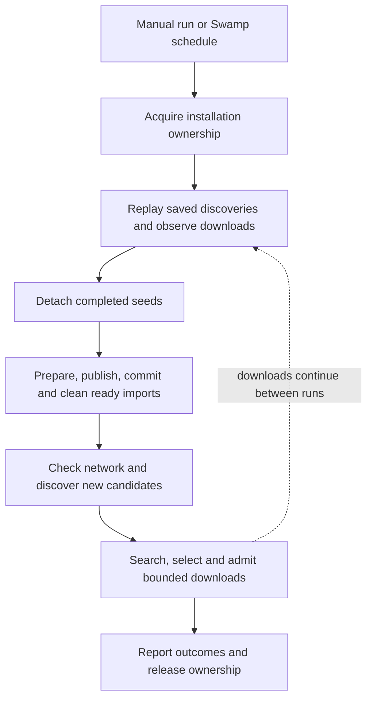

# Hoardarr

**An autonomous movie and TV library, with deterministic workflows and an agent at the controls.**

[](https://github.com/funsaized/hoardarr/actions/workflows/ci.yml)
[](LICENSE)

Give Hoardarr a list of shows and a weekly movie allowance. It discovers releases, searches for
eligible downloads, works through the TV backlog, and delivers checked copies to your library. New
episodes get priority; previous seasons follow. Each scheduled run picks up the state left by the
last one.

[Swamp](https://github.com/swamp-club/swamp) runs the schedule and workflows. Torlink handles
BitTorrent. The native VM includes Pi for questions and operator tasks: ask what arrived, inspect a
failed transfer, add a show, or change the schedule. Normal media processing needs no model calls,
interactive review queue, or running agent session.

Start with the fixture demo, choose a VPN-backed deployment, and use the same configuration and
provider contracts to extend it. This README is the canonical guide for the current source tree.

[Why Hoardarr](#why-hoardarr) · [Quick start](#quick-start) · [Run modes](#run-modes) ·
[Install](#installation) · [Media workflow](#media-workflow) · [Agent](#operator-agent) ·
[Configuration](#configuration) · [Operations](#operations) · [Commands](#command-reference) ·
[Storage](#storage) · [Providers](#providers-and-extension-points) · [Development](#development)

## Why Hoardarr

Hoardarr is for people who want to run their own media library and understand what it does. You
choose the shows, acquisition limits, storage and schedule. The workflows handle the routine work
and retain the evidence you need to inspect a decision or recover an interrupted run.

The native deployment packages that system as a VM appliance. Giving the media stack its own Linux
guest makes its network policy, runtime and lifecycle explicit:

- Keep the media VPN inside the guest. Hoardarr and Torlink run behind the guest's VPN and
  application egress guard, with Torlink bound to the tunnel interface. Your host keeps its own
  networking, VPN and Tailscale routes. A separate management identity lets you diagnose the guest
  when the media VPN fails.
- Give the stack its own operating environment. The VM has its own kernel, services and runtime
  dependencies. Hoardarr's application runs as an unprivileged user; administration uses a separate
  identity. The persistent project share defines where application data lives on the host. See the
  [trust boundaries](#trust-boundaries) for the scope of that separation.
- Deploy a known system. The image contains pinned application code and runtimes. Updates replace
  that image through DevVM, with checks against the exact runtime manifest. You can rebuild from
  recorded inputs and test an image in a separate qualification VM before putting it into service.
- Keep your library independent of the appliance. Media, catalogs, configuration and downloader
  state live in the persistent project and survive image replacement. Storage identity checks reject
  a missing or substituted mount. Explicit backup and recovery procedures preserve the state and
  credentials needed to resume work.
- Let it run without an open terminal or agent session. Host systemd starts the enrolled VM, guest
  services supervise the application, and Swamp runs the schedule. Downloads continue between
  workflow runs; each run reconciles saved progress and delivers what is ready. Pi is available
  inside the VM when you want help operating it.
- See what the automation does. Catalogs, provider results, retry times, reports and ownership
  records explain what happened. Delivery checks file sizes and SHA-256 hashes and saves a receipt
  before deleting staging files. You can pause new work, inspect an interruption and recover it
  through explicit controls.

Follow a show once and Hoardarr maintains its aired-episode backlog. Separate movie and TV budgets
bound new work: by default, 20 movie discoveries per ISO week, 20 episode searches and eight episode
submissions per run. Typed providers let you extend discovery, search, downloading, delivery and
network readiness while keeping the same workflow contracts.

Start with the fixture demo to see the full process. Choose the native VM for the appliance model,
or use Compose with Gluetun for a container deployment. Both use the same media policy and verified
delivery flow.

## Capability index

| Capability                                                     | Guide and reference                                                                         |
| -------------------------------------------------------------- | ------------------------------------------------------------------------------------------- |
| A complete run without real media or VPN credentials           | [Quick start](#quick-start)                                                                 |
| Native appliance and container deployments                     | [Run modes](#run-modes), [installation](#installation)                                      |
| Weekly movies, automatic series resolution and season backfill | [Discovery and backlog](#discovery-and-backlog)                                             |
| Release matching, retries and independent budgets              | [Selection and limits](#selection-and-limits)                                               |
| Pi login, defaults, network access and operator requests       | [Operator agent](#operator-agent)                                                           |
| Shows, paths, providers, quality and scheduling                | [Configuration](#configuration)                                                             |
| Status, manual runs, maintenance and schedule changes          | [Operations](#operations)                                                                   |
| Catalog state, downloader progress and durable storage         | [Media workflow](#media-workflow), [storage](#storage)                                      |
| Interrupted work, backups and VM replacement                   | [Recovery](#recovery), [image deployment](#image-deployment)                                |
| CLI, Swamp access and service controls                         | [Command reference](#command-reference)                                                     |
| Custom providers and verified delivery contracts               | [Providers](#providers-and-extension-points)                                                |
| VPN isolation, credentials and security reporting              | [Trust boundaries](#trust-boundaries)                                                       |
| Source map, checks, image inputs and publication               | [Implementation index](#architecture-and-implementation-index), [development](#development) |

## Quick start

Use Linux, Deno 2.9.8 and the pinned official Swamp build from [runtime inputs](#runtime-inputs).
Swamp requires a login even for fixture work and public extension installation.

```sh
git clone https://github.com/funsaized/hoardarr.git
cd hoardarr
swamp auth login
bin/hoardarr init --profile demo --dir "$HOME/hoardarr-demo"
bin/hoardarr doctor --dir "$HOME/hoardarr-demo"
bin/hoardarr run --dir "$HOME/hoardarr-demo"
bin/hoardarr status --dir "$HOME/hoardarr-demo"
```

The demo writes harmless text files with media filenames. It uses no torrent peers, VPN or TMDB
account. Its synthetic downloads finish immediately; delivery and cleanup use the real filesystem
implementation. Look under `~/hoardarr-demo/payload/library/Movies/Hoardarr Demo (2026)`. A
completed run reports `lease: null`. Running it again preserves completed catalog entries.

To include the fixture episode, add this to the generated `hoardarr.yaml`, then run `apply` and
`run` with the same `--dir`:

```yaml
interests:
  shows:
    - name: Hoardarr Fixture Series
      tmdbId: 1
      category: tv
```

Scheduling starts disabled. `plan` previews saved work but writes workflow history and reports;
`plan --refresh` also performs discovery and updates the catalog. Use `status` for read-only
inspection.

## Run modes

| Profile               | Deployment                      | Network and storage                                                               |
| --------------------- | ------------------------------- | --------------------------------------------------------------------------------- |
| `demo`                | Local Deno CLI and Swamp        | Offline fixture providers; local files                                            |
| `compose-vpn-local`   | Docker Compose on Linux         | Hoardarr and Torlink share Gluetun's WireGuard network; host bind mounts          |
| `devvm-nordvpn-local` | DevVM appliance on a Linux host | NordVPN and an application egress guard inside the guest; persistent host project |

All three use configuration schema 2 and the same media workflow: observe, submit bounded work,
reconcile, deliver what is ready, and release ownership. The daemons continue downloads between
runs. A large delivery batch can still take time; it holds ownership while copying and hashing.

The deployment supplies isolation and process supervision. Native additionally checks protected
installation identity, enrolled storage and commissioning evidence. Compose uses its container
network namespace and firewall. These boundaries differ; the media policy does not.

The native appliance includes Pi. Demo and Compose expose the CLI and Swamp interfaces; they do not
launch an agent. There is no web dashboard or separate Hoardarr npm package.

## Installation

### Native appliance

For an **already enrolled installation**, select its host project and isolated DevVM inventory:

```sh
cd "$HOME/.local/share/hoardarr-devvm"
export XDG_CONFIG_HOME="$HOME/.hoardarr-host/config"
export XDG_DATA_HOME="$HOME/.hoardarr-host/data"
devvm ls
devvm
```

Check that the listed VM's folder is the current directory. DevVM selects by project folder;
starting it from the source checkout can create another VM. Use the pinned executable recorded in
`~/.hoardarr-host/production-deployment.json`.

Inside the guest:

```sh
sudo hoardarr-operator native-check
sudo hoardarr-operator status
hoardarr-agent
```

Enabled services resume on boot when commissioning and admission checks pass. Exiting the shell
leaves the VM running. Host systemd starts the enrolled VM; Swamp inside it schedules the media
work.

A new appliance requires Linux x86-64, KVM, systemd, GNU tools, Btrfs project storage, and the
pinned DevVM/Lima tools. There is no preconfigured production disk containing credentials. Build
public inputs, provision privately, and qualify the exact image.

<details>
<summary>Build and provision a new appliance</summary>

Use [the runtime pins](deploy/devvm/pins.json),
[base dependencies](deploy/devvm/base-dependencies.json), and
[OS package checksums](deploy/devvm/package-checks.json). Keep the isolated XDG exports above in the
host build terminal. Run `devvm --version`, `devvm doctor`, and `devvm ls` before building.

Acquire these runtime files into a private artifacts directory:

| Filename                       | Input                                     |
| ------------------------------ | ----------------------------------------- |
| `swamp-hoardarr`               | Pinned native Swamp derivative binary     |
| `swamp-hoardarr-source.tar.gz` | Its complete corresponding source archive |
| `deno.zip`                     | Official pinned Linux x86-64 Deno archive |
| `node.tar.xz`                  | Official pinned Linux x64 Node archive    |

Acquire the locked `.deb` packages from authenticated Ubuntu and NordVPN repositories on an Ubuntu
26.04 build guest, using `apt-get download PACKAGE=VERSION` for each lock entry. The builder checks
the package hashes. Do not export runtime inputs or caches from a credentialed production guest.

From this source checkout, with pinned Deno/Node and an authenticated Swamp binary:

```sh
python3 deploy/devvm/build-public-export.py \
  --work /private/build/inputs \
  --packages /private/build/packages \
  --swamp /private/build/artifacts/swamp-hoardarr
python3 deploy/devvm/prepare-layer.py \
  --public-export /private/build/inputs/export.tar \
  --artifacts /private/build/artifacts \
  --output /private/build/layer \
  --bundle-url http://host.lima.internal:18765/runtime.tar.gz
install -d -m 700 "$XDG_CONFIG_HOME/devvm/layers"
install -m 700 /private/build/layer/hoardarr.sh "$XDG_CONFIG_HOME/devvm/layers/hoardarr.sh"
install -m 600 /private/build/layer/hoardarr.policy "$XDG_CONFIG_HOME/devvm/layers/hoardarr.policy"
```

The export includes public extensions, patched Torlink, Pi, dependency caches and checked OS
packages. Review it before redistribution. Serve only the generated `runtime.tar.gz` at the pinned
URL while building, then run `devvm build hoardarr` and `devvm images`. Keep the checked archive for
recovery and remakes; stop the temporary server afterward.

Create a private qualification project owned by the unprivileged operator:

```sh
mkdir -m 700 /ABSOLUTE/SHARED/QUALIFICATION
cd /ABSOLUTE/SHARED/QUALIFICATION
devvm --layers hoardarr --tools none --agents none --network open --ports none --no-git-protect --no-input
```

Generate an RSA recovery key on the host. Keep its private key there, mode 600; transfer only its
public key to the guest. From the management shell:

```sh
sudo hoardarr-provision fresh \
  --project /ABSOLUTE/SHARED/QUALIFICATION --purpose qualification \
  --public-key /PRIVATE/GUEST/recovery-public.pem
```

Provisioning creates identity and storage markers, the guest control checkout and observation
sockets. Media services stay disabled and admissions closed. Save Swamp's `key`/`signinToken` JSON
in `P/secrets/swamp.json`, owned by the service UID with mode 600. Store TMDB credentials through
the hidden prompt:

```sh
sudo hoardarr-operator swamp vault put hoardarr TMDB_API_KEY
```

Authenticate NordVPN as root through its supported account flow. The generated profile expects
OpenVPN TCP on `nordtun`, firewall and kill switch enabled, and autoconnect configured. Never put
account credentials in the image layer.

Run the [qualification gates](#qualification). Create a separate production project and VM using the
same image, then provision it with `--purpose production`, a fresh identity and its own credentials.
Qualification fault probes belong in the disposable guest.

Back on the host, enroll the actual VM name shown by `devvm ls`:

```sh
python3 deploy/devvm/enroll-host.py \
  --devvm /ABSOLUTE/PATH/TO/devvm \
  --project "$HOME/.local/share/hoardarr-devvm" \
  --config-home "$HOME/.hoardarr-host/config" \
  --data-home "$HOME/.hoardarr-host/data" \
  --vm ACTUAL_DEVVM_NAME \
  --backup-root /PRIVATE/SEPARATE/BACKUPS \
  --recovery-key /PRIVATE/RECOVERY/private.pem \
  --runtime-bundle /PRIVATE/BUILD/layer/runtime.tar.gz
```

Enrollment records storage, runtime and key identities. It refuses to replace an existing enrollment
and does not install a boot service. Render, inspect and install the host unit:

```sh
mkdir -p "$HOME/.hoardarr-host/reviewed"
python3 deploy/devvm/install-host.py --operator-uid "$(id -u)" --render \
  > "$HOME/.hoardarr-host/reviewed/hoardarr-devvm.service"
cat "$HOME/.hoardarr-host/reviewed/hoardarr-devvm.service"
sudo python3 deploy/devvm/install-host.py --operator-uid "$(id -u)"
```

Complete production commissioning, [resume the guest services](#pause-and-resume), and verify a
manual run before enabling the schedule. Retain the enrollment, key and exact image inputs
privately.

</details>

### Compose

Use Linux x86-64, Docker with Compose, `/dev/net/tun`, a provider WireGuard configuration, a TMDB
key, and Swamp credentials. Build the image from the same checkout as this README:

```sh
docker build -t hoardarr:local .
bin/hoardarr init --profile compose-vpn-local --dir "$HOME/hoardarr-instance"
cd "$HOME/hoardarr-instance"
cp .env.example .env
```

Set `HOARDARR_UID` and `HOARDARR_GID` to the owner of the instance and payload directories. The
local build is the default image; `HOARDARR_IMAGE` can select a published image matching your source
release. For a NAS, mount it on the host and change the library bind mount in `compose.yaml`.

Create these private files, mode 600 and readable by the configured UID:

| File                         | Contents                                                    |
| ---------------------------- | ----------------------------------------------------------- |
| `secrets/wg0.conf`           | Provider WireGuard configuration tunneling all IPv4 traffic |
| `secrets/gluetun-auth.toml`  | Copy the supplied example and set a random control API key  |
| `secrets/swamp-api-key`      | Swamp API key for unattended commands                       |
| `secrets/swamp-signin-token` | Matching Swamp sign-in token                                |

See `swamp auth` for account commands. Start the services and store the application keys:

```sh
docker compose up -d
docker compose logs --tail 50 hoardarr
docker compose exec hoardarr swamp vault put hoardarr TMDB_API_KEY --repo-dir /instance
docker compose exec hoardarr swamp vault put hoardarr GLUETUN_API_KEY --repo-dir /instance
```

The Gluetun vault value must match `gluetun-auth.toml`. Both application containers share Gluetun's
network namespace, drop capabilities, and publish no host ports. Only Gluetun receives `NET_ADMIN`.
The profile disables IPv6. Leave its firewall enabled.

Edit the host's `hoardarr.yaml`. Apply configuration with stopped scheduling, then verify and run:

```sh
docker compose stop hoardarr
docker compose run --rm hoardarr apply --dir /instance --config /config/hoardarr.yaml
docker compose up -d hoardarr
docker compose exec hoardarr /opt/hoardarr/bin/hoardarr doctor --dir /instance --live
docker compose exec hoardarr /opt/hoardarr/bin/hoardarr run --dir /instance
```

Let any active reconciliation finish before stopping the scheduler. Set `schedule.enabled` in the
host configuration to control unattended runs; startup reads that file. Before an image update, stop
writers and back up configuration, secrets, `instance`, `runtime-home`, Torlink state and the chosen
media scope. Rebuild or pull the selected image, then start and check it.

## Media workflow



The root `media` Swamp workflow owns observation, discovery, acquisition, delivery and recovery
child workflows. The CLI generates the DAG from validated configuration. Typed behavior methods
perform outside work; CEL expressions pass their evidence to later steps. Providers cannot
substitute a previous successful snapshot for a failed current call. Already-ready imports and
pending cleanup finish before new discovery or acquisition. Network failures and admission capacity
checks therefore leave completed local work intact. If the downloader is unavailable, saved ready
items can still import. Saved discoveries replay idempotently, including after interrupted catalog
ingestion.

A single installation owner protects manual and scheduled runs. Another tick cannot start a second
writer. Ownership does not expire merely because time passed. After an interruption, recover the
saved owner after proving writers have stopped.

### Discovery and backlog

**Movies.** TMDB discovery requests digitally released movies (`with_release_type=4`) released on or
before today, for the configured region/language, ordered by popularity. It examines at most ten
result pages and excludes known IDs. The allowance counts new catalog discoveries per UTC ISO week;
it is not a torrent count and does not mean every title was released that week.

A completed marker for that week, region and language prevents another discovery batch. Raising
`interests.limit` does not top up an already completed week. Existing catalog work can still search,
download and transfer. Do not delete discovery markers to force more results.

**TV.** Configure a name, optional premiere year, and optional TMDB series ID. A supplied ID pins
the series. Otherwise, lookup matches a normalized title or original title, applies the year when
given, and breaks ties by popularity then ID. It saves the selected identity and reports title, year
and TMDB link in status. No credible match stays pending for a later run; no approval queue is
required.

Discovery catalogs aired episodes from regular seasons, including previous seasons. Specials and
future episodes stay out of the queue. Each later discovery sees newly aired episodes. The backlog
retains completed and in-flight identities across runs and restarts.

Episodes aired in the last seven days form the first priority group. Within each group, work rotates
among shows, starting with the least recently served, and proceeds from newer episodes to older
ones. Search and submission fairness use persistent state. A no-match or provider error gets its own
recorded outcome and retry time, allowing other episodes to progress.

### Selection and limits

| Control                      | Default | Meaning                                                             |
| ---------------------------- | ------- | ------------------------------------------------------------------- |
| `interests.limit`            | 20      | New movie discoveries per ISO week; 1 to 50                         |
| `television.searchesPerRun`  | 20      | Episode searches per run; 1 to 100                                  |
| `television.downloadsPerRun` | 8       | New episode submissions per run; 1 to 100                           |
| `television.retryHours`      | 24      | Episode search cooldown; 1 to 720 hours                             |
| `download.seedTime`          | `5m`    | Requested seeding duration                                          |
| `download.concurrency`       | 4       | Torlink operation concurrency; **not a simultaneous-torrent limit** |
| `download.minFreeBytes`      | 20 GiB  | Required free staging space; demo uses zero                         |

TV budgets do not consume the weekly movie allowance. The pipeline also caps each combined search
and submission batch at 100 items. These controls do not cap the total in-flight queue or the number
of ready items delivered in a run.

The default release policy requires 1080p `WEB`, `WEB-DL` or `WEBRip`, at least five seeders, and at
most 15 GiB per movie or 8 GiB per episode. It rejects camera releases, executable/archive names and
TV packs. Higher seeder counts rank first, with deterministic tie-breaking. Policies can change
resolution, size, seeders, source allowlists, ranking and failure-attempt limits.

TV matching checks the complete normalized series prefix before the episode token, season, episode,
and any stated series premiere year. TV uses `SxxExx`; the anime category uses `NxNN`. Numeric words
that are part of a title remain part of its identity. Season packs, multi-episode releases and
absolute-number-only anime releases are outside the episode coverage model.

Reconciliation checks the downloader's actual episode name before delivery. A mismatch blocks the
item, records the rejected hash, and removes that torrent and its local payload through the
workflow. Retry becomes eligible only after a fresh snapshot confirms removal. A hash also claimed
by another valid item remains blocked for operator inspection.

### Delivery and status

| State or status field            | What it means                                            |
| -------------------------------- | -------------------------------------------------------- |
| `wanted`                         | Cataloged and awaiting an eligible search                |
| `selected`                       | A release was selected; submission has not completed     |
| `downloading`                    | Downloader work is in progress                           |
| `seeding`                        | Download completed; seeding is still active              |
| `seed-stopped`                   | Seeding ended; detachment and delivery may follow        |
| `transfer-ready`                 | Payload is detached and eligible for checked delivery    |
| `transferred`                    | A verified destination receipt is recorded               |
| `cleanup-pending`                | Legacy pending cleanup; retried without another download |
| `failed` / unavailable reporting | Inspect the recorded error, attempt count and next retry |

Status separates selected, downloading, seeding, ready and completed TV counts. Downloader
observations are **saved snapshots** with timestamps, not continuous live readings. A successful
workflow may still contain source-specific search errors; inspect `searchHealth` and reports.

Each import has four Swamp steps: `prepare`, `publish`, `commit`, and `cleanup`. Preparation stages
and names the files and creates one source manifest. Publication copies and verifies each listed
file, then atomically publishes it without replacing conflicting content. The catalog records the
verified location before cleanup. The uninterrupted local path reads each source once for its hash
and each destination once for verification; retries and changed files require fresh checks.
`transferred` stays complete while `localCleanedAt` tracks pending staging cleanup.

Movies use `Movies/Title (Year)/Title (Year).ext`. Episodes share
`TV/Show (Year)/Season 01/Show - S01E01 - Episode Title.ext`. Subtitle language suffixes survive the
rename. Hoardarr omits missing years. Swamp retains IDs and a stable folder per movie or series; an
ID suffix resolves a collision between catalog titles. Ambiguous videos and conflicting files record
an item error while other imports continue. A receipt proves copy integrity, not the truth of a
release label or completion by a separate cloud-sync client.

Use [`organize --dry-run`](docs/how-to/organize-library.md) to preview existing library names, then
`organize` to move completed local copies through the same import steps. This preserves completed
catalog identities and acquisition history. Explicit `library.titleOverrides` let an operator or
agent choose a name that later runs apply deterministically.

## Operator agent

Run `hoardarr-agent` inside the native VM as the management user, without sudo. On first use, enter
`/login`, select the OpenAI Codex ChatGPT subscription login, and complete Pi's browser flow. If the
remote callback cannot reach the VM, follow Pi's prompt to paste the redirect URL privately.

The image pins Pi and ships defaults for **`openai-codex/gpt-6-luna` with `xhigh` reasoning**,
`codemode` and automatic compaction. The launcher copies its settings and instructions into a
private writable workspace so Pi can lock its files. Authentication and sessions persist outside the
image. Explicit Pi command options can select a different model for a session.

Include a title and year when requesting media so the agent can resolve the intended TMDB entry. Try
requests such as:

```text
Give me a read-only health summary. Include snapshot timestamps, backlog and source errors.
Track Severance (2022), including its aired backlog and new episodes. Report the matched TMDB entry.
Add Arrival (2016) to the movie catalog for the normal workflow to acquire. Preserve any existing progress.
Download Severance (2022) season 1 episode 3.
Download the entire series of The Good Place (2016), including only episodes aired so far.
Get the latest aired episode of Severance (2022).
Finish the remaining episodes of The Good Place (2016).
Change the weekly movie discovery allowance to 10 and keep my TV search and download limits unchanged.
Explain why this episode has not transferred, using the saved reports and catalog.
Pause new work for maintenance, wait for the current owner, and report when it is safe to stop.
```

The agent has internet access through the VM's VPN and can fetch URLs or call APIs through code and
command-line tools. No dedicated browser or web-search integration is configured. ChatGPT login
supplies model authentication, not ChatGPT's browser tools.

Pi is an operator with the management user's privileges, including authorized sudo operations. Its
instructions require Swamp commands, maintenance controls and image-based application updates.
Closing Pi does not stop scheduled work. Its requests and model usage are separate from the
scheduled deterministic media workflow.

One-off requests use `hoardarr-operator request`: resolve a title, submit a finite scope, then read
its status. Pi translates the conversation into those typed commands. A request records the selected
TMDB identity and survives the agent session. The existing `media` workflow acquires it, preserving
completed copies and downloads already in progress. An entire-series request covers regular episodes
aired by its acceptance date; ongoing tracking remains an explicit configuration change.

The request command attempts an immediate run when the installation is idle. Busy requests wait for
the existing schedule; closed admissions reject new intake. Requests share the configured release
policy, storage checks and acquisition budgets. Explicit movies remain eligible when automatic movie
discovery is off and do not consume its weekly allowance. See
[one-off requests](docs/how-to/operate-native.md#request-a-movie-or-episodes) for scopes and
commands.

## Configuration

Edit the installation's `hoardarr.yaml`, then apply it with the appropriate maintenance procedure.
The [schema](src/config.ts) rejects unknown fields. Do not edit generated workflow YAML to change
policy or schedule intent.

Merge this settings fragment into the configuration generated by installation. Keep its paths and
native identity:

```yaml
interests:
  movies: true
  region: US
  language: en-US
  limit: 20
  shows:
    - name: Time
      year: 2021
      tmdbId: 126116
      category: tv
    - name: "The Lord of the Rings: The Rings of Power"
      year: 2022
      tmdbId: 84773
      category: tv
television:
  searchesPerRun: 20
  downloadsPerRun: 8
  retryHours: 24
download:
  seedTime: 5m
  concurrency: 4
  minFreeBytes: 21474836480
schedule:
  enabled: false
  cron: "0 2,8,14,22 * * *"
tmdbKey: '${{ vault.get("hoardarr", "TMDB_API_KEY") }}'
```

| Field                                 | Contract                                                                               |
| ------------------------------------- | -------------------------------------------------------------------------------------- |
| `schemaVersion`                       | `2`                                                                                    |
| `profile`                             | One of the three [run modes](#run-modes)                                               |
| `paths.staging`, `.state`, `.library` | Absolute, distinct roots without overlap or parent traversal                           |
| `guest`                               | Native-only protected identity, protocol and storage mapping; provisioning supplies it |
| `providers`                           | Binding IDs for discovery, search, downloader, destination and network                 |
| `providerFiles`                       | Absolute paths to additional provider descriptors                                      |
| `providerSettings`                    | Behavior global arguments keyed by provider binding ID                                 |
| `interests`                           | Movie flag, region, language, weekly limit and up to 100 configured shows              |
| `interests.shows[]`                   | Required `name`; optional `tmdbId`, `year`; `category` is `tv` or `anime`              |
| `television`                          | Independent search/submission budgets and retry cooldown                               |
| `policies.movie`, `.episode`          | [Selection policy schema](extensions/models/_lib/policy.ts)                            |
| `download`                            | Seeding, operation concurrency and staging capacity settings                           |
| `schedule`                            | Enabled flag and five-field cron expression                                            |
| `torlink`                             | CLI binary, loopback API URL, optional vault token and tunnel interface                |
| `tmdbKey`                             | Vault expression; default key is `hoardarr/TMDB_API_KEY`                               |

Policy fields are `version: 1`, `minSeeders`, `maxSizeBytes`, `resolution` (`720p`, `1080p`,
`2160p`), `sources`, `ranking` and `maxAttempts` (default three). `sources` is an allowlist when
nonempty. The `legacy` ranking value means seeders, then name, then hash; `source-priority` means
seeders, then configured source order, then hash. It does not override the seeder ranking.

Torlink defaults to `http://127.0.0.1:9161`. This implementation requires local payload access;
remote daemon payload mapping is unsupported. Native fixes the binary to `/opt/torlink/dist/cli.cjs`
and binds the tunnel interface. Secrets use vault expressions or private files; do not put
credential literals in YAML.

Native keeps effective schedule activation in a separate installation-bound record. Use
`schedule enable|disable` and `status`; editing the YAML flag alone does not change native
activation. Compose reads the host-mounted YAML at startup.

## Operations

Commands in this section run **inside the native VM**. For Compose, invoke the same CLI through
`docker compose exec hoardarr /opt/hoardarr/bin/hoardarr … --dir /instance`. For the demo, use
`bin/hoardarr … --dir INSTANCE` from the source checkout.

### Inspect and run

```sh
sudo hoardarr-operator status
sudo hoardarr-operator swamp workflow schedule list --json
sudo hoardarr-operator run
```

`status` reads retained observations. `run` performs real discovery, acquisition, delivery and
cleanup. `doctor`, `native-check` and provider methods can write probe observations or reports;
`plan` is not a read-only command.

For a problem, inspect the report before retrying:

```sh
sudo hoardarr-operator swamp workflow history media --json
sudo hoardarr-operator swamp report get @swamp/workflow-summary --workflow media --json
sudo hoardarr-operator swamp report get @swamp/method-summary --model NAME --json
sudo journalctl -u hoardarr-swamp -u hoardarr-torlink --since today
```

Keep journals, acquisition locators and private paths out of public issues. A provider's 401, 451 or
no-match result is not proof that the whole workflow failed; inspect each source and the item's
retry state. If a DevVM host-proxy warning appears, check native readiness and the agent separately:
their launchers use a direct VPN environment and fixed DNS instead of inheriting the shell proxy.

### Pause and resume

Close new admissions, then let the current owner finish:

```sh
sudo hoardarr-operator inhibit --reason "Maintenance"
sudo hoardarr-operator status
```

When `lease` is `null`, stop application writers:

```sh
sudo systemctl stop hoardarr-swamp.service hoardarr-torlink.service
sudo systemctl is-active hoardarr-swamp.service hoardarr-torlink.service
```

Both should report `inactive` (a nonzero `is-active` exit is expected). Leave the VPN and
observation sockets running for ordinary maintenance. Use the recovery procedure if a failed run
still owns the installation. Never delete its lease to unlock it.

After maintenance, execute each step only after the previous one succeeds:

```sh
sudo hoardarr-operator doctor
sudo hoardarr-operator admit
sudo systemctl enable --now hoardarr-torlink.service hoardarr-swamp.service
sudo hoardarr-operator native-check
sudo hoardarr-operator status
```

For a VM restart, pause first, exit to the host, run `devvm restart`, then resume inside the guest.
A restart keeps the installed image; it does not deploy new application code.

### Change shows, limits or schedules

For shows, limits or cron changes, pause and stop writers, edit `P/hoardarr.yaml`, run
`sudo hoardarr-operator apply --no-pull`, then resume. `P` is the persistent project root.

To change native schedule activation, wait for `lease: null`, stop Swamp and Torlink, then run
`sudo hoardarr-operator schedule enable` or `schedule disable`. Enabling requires commissioning and
open admissions before the configuration transaction. Afterward run `admit` and restart the
services. The transaction closes admissions while it updates definitions.

Cron uses the Swamp server process's local time zone. Native launchers remove inherited `TZ`, so the
guest OS time zone applies. The default expression runs at 02:00, 08:00, 14:00 and 22:00. Swamp
skips missed slots after downtime. systemd keeps processes available; it is not the media scheduler.

For a demo schedule, set its cron in YAML, run `schedule enable --dir INSTANCE`, then start
`swamp serve --repo-dir INSTANCE --host 127.0.0.1 --port 9090`. Scheduled inputs authorize real
work; only fixture providers make the demo harmless.

## Command reference

Use `bin/hoardarr help` for local CLI discovery. `sudo hoardarr-operator` selects the protected
native installation, service environment and configuration. It deliberately rejects custom `--dir`,
`--config` and `--repo-dir` overrides. `sudo hoardarr-operator swamp help` discovers Swamp commands.

| CLI command                                                     | Purpose and effects                                                                                   |
| --------------------------------------------------------------- | ----------------------------------------------------------------------------------------------------- |
| `init --profile demo\|compose-vpn-local --dir PATH`             | Create a new installation with scheduling disabled                                                    |
| `apply [--no-pull]`                                             | Generate and validate definitions from configuration; native requires stopped writers                 |
| `doctor [--live]`                                               | Check pins, extensions, provider contracts, paths and required keys; optional daemon health           |
| `status`                                                        | Read catalog, show identity, TV backlog, retries, saved downloader state, source errors and ownership |
| `plan [--refresh]`                                              | Record a preview workflow; `--refresh` also changes discovery/catalog state                           |
| `organize [--dry-run]`                                          | Preview or apply canonical names to completed local library copies                                    |
| `run`                                                           | Execute one owned reconciliation                                                                      |
| `schedule enable\|disable`                                      | Update schedule activation and generated definitions                                                  |
| `inhibit --reason TEXT`                                         | Persistently close new admissions; the current owner may finish                                       |
| `admit`                                                         | Reopen native admissions after readiness, commissioning and ownership checks                          |
| `native-check`                                                  | Check native readiness, identity, storage, admission and downloader state                             |
| `recover`                                                       | Reconcile an interrupted media owner; native also verifies stopped writers                            |
| `recover-apply --journal PATH`                                  | Recover the exact native configuration transaction                                                    |
| `backup [--backup-dir PATH]`                                    | Archive installation state; native requires complete stopped-writer/capsule checks                    |
| `restore --snapshot PATH --mapping JSON_FILE`                   | Verify a complete snapshot into explicit new roots                                                    |
| `recover-maintenance --snapshot PATH --owner UUID`              | Release only the restored snapshot's verified maintenance owner                                       |
| `migration inventory --output PATH`                             | Save a private semantic inventory                                                                     |
| `migration compare --before PATH --after PATH [--mapping PATH]` | Compare identities, catalogs, receipts and payloads                                                   |
| `migration prepare --mapping JSON_FILE --snapshot PATH`         | Journal an explicit relocation using a complete snapshot                                              |
| `migration resume --session UUID`                               | Continue that relocation                                                                              |
| `native-init`                                                   | Provisioning entry point for a fresh root-identified guest; not an ordinary setup shortcut            |

Local commands accept `--dir PATH`, optional `--config PATH`, and `--json`. `migration` describes
storage relocation and inventory verification, not an importer for a retired deployment format.

| Host command                                     | Purpose                                                                          |
| ------------------------------------------------ | -------------------------------------------------------------------------------- |
| `devvm ls`                                       | Inspect the selected inventory and project folders                               |
| `devvm`                                          | Start and enter the current project's VM                                         |
| `devvm host`                                     | Show its management hostname                                                     |
| `devvm stop`, `devvm restart`                    | Stop or restart after maintenance preparation                                    |
| `devvm build hoardarr`, `devvm rebuild hoardarr` | Build the registered application layer                                           |
| `devvm images`                                   | Inspect available image chains                                                   |
| `devvm update`                                   | Replace the guest from its image; requires credential recovery and commissioning |
| `systemctl status hoardarr-devvm.service`        | Inspect automatic host boot integration                                          |

Guest services are `hoardarr-swamp`, `hoardarr-torlink`, `nordvpnd` and `hoardarr-egress-guard`.
Swamp listens on guest loopback 9090, Torlink on 9161. The host helper
`~/.hoardarr-host/tools/bin/hoardarr-host-operator` can invoke the protected operator through its
enrolled management transport.

## Storage

For the standard native installation, `P` is `$HOME/.local/share/hoardarr-devvm` on the host. DevVM
shares it into the guest at the same absolute path through 9p. It survives image replacement.

| Location                                           | Contents                                                                                      |
| -------------------------------------------------- | --------------------------------------------------------------------------------------------- |
| `P/hoardarr.yaml`                                  | Operator configuration                                                                        |
| `P/instance/datastore`                             | Swamp managed definitions, catalogs, backlog, discovery markers, outputs, reports and history |
| `P/instance/control-plane`                         | Durable Swamp control-plane state                                                             |
| `P/instance/checkout.json`                         | Repository identity and datastore mapping used to rebuild the checkout                        |
| `P/state/torlink`                                  | Downloader queue, history, seeds, configuration and torrent metadata                          |
| `P/state/maintenance`                              | Ownership, admissions, schedule activation, transaction journals and commissioning evidence   |
| `P/downloads`                                      | In-progress and staged payloads                                                               |
| `P/library/Movies/Title (Year)`                    | Named movie directories; catalog retains TMDB identity                                        |
| `P/library/TV/Show (Year)/Season NN`               | Shared season directories with named episode files                                            |
| `P/runtime-home/.config/swamp`                     | Private Swamp user configuration                                                              |
| `P/runtime-home/pi-agent`                          | Pi authentication, sessions and writable operator workspace                                   |
| `P/secrets`                                        | Private credentials, vault storage and encrypted guest-recovery capsule                       |
| Guest `/var/lib/hoardarr/control`                  | Rebuildable Swamp checkout and local indexes on ext4                                          |
| Guest `/opt/hoardarr`                              | Image-supplied application, README and extensions                                             |
| Guest `/etc/hoardarr`                              | Protected installation identity, commissioning and runtime policy                             |
| Guest `/var/cache/hoardarr`                        | Rebuildable caches                                                                            |
| Host `~/.hoardarr-host/config/devvm`               | Isolated DevVM configuration and registered layers                                            |
| Host `~/.hoardarr-host/data/devvm`                 | VM inventory, image chains and guest disks                                                    |
| Host `~/.hoardarr-host/production-deployment.json` | Enrollment and recovery paths                                                                 |

The source Git checkout contains code and shipped defaults. Live configuration, credentials, media,
Pi conversations and Swamp state do not belong in Git. Inspect Swamp data with Swamp commands rather
than editing datastore files.

Native storage markers bind every preserved root to its installation. A missing mount, replaced root
or symlink causes an error; it cannot initialize an empty catalog. Durable writes use
write/sync/rename/parent sync; journals retain incomplete operations.

Compose keeps `instance`, `runtime-home`, `secrets`, `hoardarr.yaml`, and `payload` under its chosen
host installation directory. The demo keeps its Swamp installation under `--dir` and media under
`payload`. Their layouts do not imply native commissioning or Btrfs identity checks.

## Recovery

### Interrupted processing

Inspect the workflow report before attempting recovery. In native operation:

```sh
sudo hoardarr-operator swamp report get @swamp/workflow-summary --workflow media --json
sudo hoardarr-operator inhibit --reason "Interrupted run recovery"
sudo hoardarr-operator status
sudo systemctl stop hoardarr-swamp.service hoardarr-torlink.service
sudo hoardarr-operator recover
```

Native recovery verifies that Swamp/manual writers stopped; its controlled recovery path makes the
local downloader snapshot available. Recovery reconciles durable state before releasing ownership.
If that observation fails, ownership remains held. Review the result and
[resume](#pause-and-resume).

For Compose, stop the scheduler and prove no manual writer remains before recovery. Keep its local
downloader available for the reconciliation. An active Swamp run record needs diagnosis with
`swamp run doctor`; elapsed time alone does not authorize clearing it.

Configuration and snapshot maintenance have different owners. Use `recover-apply` for its exact
journal, or `recover-maintenance` for the snapshot's recorded UUID. Do not create a new owner or
remove a lease file to bypass these checks.

### Backup and restore

After native enrollment, run the host helper from the physical host:

```sh
"$HOME/.hoardarr-host/tools/bin/hoardarr-host-backup" \
  --deployment "$HOME/.hoardarr-host/production-deployment.json"
```

It validates the installation/key pair, closes admissions, stops writers, exports an encrypted root
credential capsule, takes a complete snapshot, copies it into private backup storage and verifies
hashes. Review the result before resuming. Keep an off-machine copy of the recovery key and
manifest; a VM disk or `devvm history` alone does not contain all persistent state.

Restore offline from source into **new explicit paths**, using a mapping file such as:

```json
{
  "project": "/srv/hoardarr-restore/project",
  "checkout": "/srv/hoardarr-restore/control"
}
```

```sh
bin/hoardarr restore --snapshot /private/backup/SNAPSHOT --mapping /private/restore-mapping.json
```

Restore verifies hashes and retains maintenance ownership with admissions closed. Complete the
matching maintenance recovery and native credential/provisioning steps before admission. If a
catalog snapshot predates actual downloads or delivered files, reconcile those effects before
resuming. The relocation commands record progress in a journal and require a complete snapshot.

## Image deployment

Application/runtime changes belong in the DevVM image. Restarting services or pulling host source
alone does not deploy them. Never patch `/opt/hoardarr` or installed runtimes in place.

1. Build fresh public inputs and a layer from the intended source. Run `devvm rebuild hoardarr` and
   inspect `devvm images`.
2. Pause the old installation and stop application writers. Preserve the operator's chosen backup
   and qualification scope. A full media backup and the required credential handoff are separate.
3. Stop NordVPN's credential writers in the old guest, then export the encrypted capsule:

   ```sh
   sudo systemctl stop nordvpnd.service nordvpnd.socket
   sudo /usr/local/libexec/hoardarr-recovery-capsule export
   ```

4. Retain `P/secrets/guest-recovery.json`. Exit and run `devvm update` from the selected host
   project. Keep normal project/home preservation enabled.
5. On the host, decrypt the capsule into a new private directory with its matching key:

   ```sh
   python3 deploy/devvm/recovery-capsule.py decrypt CAPSULE PRIVATE_KEY NEW_DIRECTORY
   ```

6. Transfer only that recovery directory with `devvm limactl copy --backend=scp`. The private key
   stays on the host. In the replacement guest, stop NordVPN writers and rehydrate:

   ```sh
   sudo systemctl stop nordvpnd.service nordvpnd.socket
   sudo hoardarr-rehydrate --source /PRIVATE/GUEST/RECOVERY
   sudo systemctl start nordvpnd.service
   sudo nordvpn status
   sudo hoardarr-provision rebuild --project /ABSOLUTE/SHARED/PROJECT
   ```

   Confirm the restored VPN connection before running provisioning, which needs network access for
   extension checks. Rehydration restores installation identity and credentials, not the old runtime
   or commissioning authority. Provisioning reconstructs the control checkout and reconnects
   persistent Swamp data.
7. Compare private inventories from before/after replacement, complete exact-image qualification,
   and commission. Refresh the enrolled bundle path/hash, runtime manifest hash, VM record and image
   chain used by the host verifier. Keep installation and storage identities intact.
8. Run `sudo hoardarr-operator apply --no-pull`, then the [resume procedure](#pause-and-resume).
   Verify configuration, schedule and readiness. Remove temporary decrypted credential copies.

### Qualification

Qualification records observations for an exact runtime manifest and installation. A passing unit
suite or a branch name is insufficient. Keep fault probes and evidence private, outside the public
source tree.

| Gate | Required observations                                                                                                                                 |
| ---- | ----------------------------------------------------------------------------------------------------------------------------------------------------- |
| G1   | Rebuild from pinned public inputs; inspect licenses, immutable code and environment isolation                                                         |
| G2   | Real Torlink traffic under tunnel loss/recovery, disconnect, daemon failure and missing authentication; IPv4/IPv6/DNS and proxy/relay bypass attempts |
| G3   | Storage identity refusal, durable publication, large-file hashes, interruption/overlap handling, complete backup and restore                          |
| G4   | Extension loading, workflow validation, authenticated manual and scheduled fixture acquisition through delivery/cleanup                               |
| G5   | Semantic inventories, typed path mappings, relocation rehearsal and interrupted relocation recovery                                                   |
| G6   | Production canary, unattended physical reboot, VM remake, complete restore and recovery-key escrow                                                    |

The [qualification tools](deploy/devvm/qualification) support these checks; they do not certify the
whole matrix automatically. Use a separate `purpose: qualification` guest for destructive fault
tests. Btrfs tests skip on other filesystems; container firewall tests do not qualify NordVPN.

<details>
<summary>Commissioning evidence and upgrade waivers</summary>

Fill this structure from actual observations; retain supporting evidence privately:

```json
{
  "schemaVersion": 1,
  "runtimeManifestSha256": "SHA256_OF_INSTALLED_RUNTIME_MANIFEST",
  "gates": {
    "G1": { "passed": false },
    "G2": { "passed": false },
    "G3": { "passed": false },
    "G4": { "passed": false },
    "G5": { "passed": false },
    "G6": { "passed": false }
  }
}
```

Run `sudo hoardarr-commission commissioning --evidence PATH` after G1 through G5, then
`sudo hoardarr-commission production --evidence PATH` after G1 through G6. The command checks
manifest, protected files, identity, closed admissions and live VPN guard. Evidence is the root
operator's attestation, not cryptographic proof that a test happened.

For an upgrade of an already commissioned installation, the operator may explicitly waive G2, G3 and
G6. Each waived gate requires `passed: false`, `waived: true` and a specific `reason`. Include
`operatorAuthorization` and `previousRuntimeManifestSha256`; pass `--allow-waived-upgrade-checks`.
G1, G4 and G5 still require passing evidence. Fresh installations cannot use this exception.

</details>

## Providers and extension points

A provider is a Swamp behavior plus a JSON descriptor naming its type, exact version, roles,
capabilities and method mapping. [Contracts](extensions/models/_lib/contracts.ts) validate required
operations and evidence; Swamp validates the behavior's arguments. The descriptor's `configuration`
field supplies reference metadata; it does not perform validation.

| Role        | Required operations                | Evidence                                                                 |
| ----------- | ---------------------------------- | ------------------------------------------------------------------------ |
| Discovery   | `movies`, `episodes`               | `digital-release-movie-ID`, `aired-episode-ID` records                   |
| Search      | `search`                           | `search-current.queries[]`, keyed by the caller                          |
| Downloader  | `health`, `add`, `sync`, `control` | Capabilities, per-input add/control results and a fresh torrent snapshot |
| Destination | `deliver`                          | `receipt-KEY` matching the requested manifest                            |
| Network     | `inspect`, `assertReady`           | A failed readiness assertion throws; deployment owns network isolation   |

Built-in bindings are `tmdb`, `torlink`, `local`, `ssh`, `guest-nordvpn`, `gluetun` and `fixture`.
The downloader must support local payload access and the destination must produce verified receipts.
Changing an in-flight item's downloader without reconciling it is an error.

To add a provider, search Swamp's extension registry and installed types first. Pull or extend an
existing type where possible. Add a descriptor to `providerFiles`, select its ID under `providers`,
and supply its global arguments through `providerSettings[ID]`. Native's protected profile fixes its
network/downloader/local-storage bindings; additional native integration needs an image and reviewed
storage/network policy.

The [example destination descriptor](examples/provider/verified-library.json) and
[implementation](examples/provider/verified_library.ts) exercise a custom library without changing
the catalog. In a demo installation, copy both files beside the installed destination
implementation:

```sh
cp examples/provider/verified_library.ts /path/to/instance/extensions/models/
cp examples/provider/verified-library.json /path/to/instance/verified-library.json
```

Configure `providerFiles` with that descriptor, set `providers.destination: example-library`, and
set its `stagingRoot`/`libraryRoot` under `providerSettings.example-library`. Apply, run `doctor`,
then exercise a real fixture delivery. A separately published extension must include its imported
files.

The SSH destination uses an existing `@swamp/ssh` behavior. Supply `sshModel`, `host`, `movies` and
`episodes` under `providerSettings.ssh`; the installer supplies the staging root. Configure
transport keys and host verification through that SSH behavior. It must be reachable through the
deployment's network boundary; selecting SSH does not disconnect the VPN or change host routing.

`TransferSchema` contains the media key/kind, staging root, relative paths, byte sizes, file hashes,
total bytes and aggregate hash. The aggregate is SHA-256 of lexically sorted `HASH  RELATIVE_PATH\n`
lines. A destination rejects traversal, symlinks, extra files and conflicting content, verifies each
file, returns a receipt and retains the source. Hoardarr validates/persists the receipt and
separately authorizes cleanup.

Use [Swamp data and CEL expressions](https://github.com/swamp-club/swamp) to connect behavior
outputs. Reusable analysis belongs in a report extension. Do not introduce another scheduler or
mutate the catalog from an independent daemon. Provider code runs with application privileges;
review it as executable policy.

## Trust boundaries

The native application runs as an unprivileged UID outside the NordVPN control group. A root status
broker reports VPN state; an egress guard restricts application traffic; Torlink binds the tunnel
interface. Application launchers clear inherited proxies and use the service DNS configuration. The
management shell retains administrative access for diagnosis. The host's networking stays under host
control.

Compose puts both application processes in Gluetun's network namespace. Keep control APIs on
loopback, the firewall enabled, and outbound exemptions narrow. Readiness checks observe current
conditions; the firewall enforces the boundary when the tunnel fails afterward.

Root, the Docker daemon, the host administrator and a compromised guest kernel are outside these
boundaries. Pi has operator privileges, not the restricted service boundary. Treat media filenames,
provider responses and logs as untrusted input. Download only material you are authorized to
acquire.

Public images contain code and dependencies, never operator credentials. Private files, inventories,
backups and logs can contain credentials or acquisition locators. Pins make inputs reviewable;
security updates still require an explicit rebuild and verification.

Report vulnerabilities through the repository's private GitHub security reporting channel when
available. Otherwise, contact the maintainer through their GitHub profile to arrange a private
report. Do not post secrets or private diagnostics in public issues.

## Architecture and implementation index

```text
hoardarr.yaml -> Deno CLI -> Swamp behaviors and workflow DAG
                               |
                +--------------+----------------+
                |              |                |
          TMDB discovery   Torlink daemon   verified destination
                |              |                |
                +------ persistent catalogs -----+
                               |
                    reports, status and Pi operator
```

| Source                                                                                                                     | Responsibility                                                  |
| -------------------------------------------------------------------------------------------------------------------------- | --------------------------------------------------------------- |
| [cli/main.ts](cli/main.ts)                                                                                                 | Operator commands and dispatch                                  |
| [src/config.ts](src/config.ts), [src/install.ts](src/install.ts)                                                           | Configuration schema, installation and definition generation    |
| [src/workflows.ts](src/workflows.ts)                                                                                       | Owned discovery/acquisition/delivery/recovery DAG               |
| [src/providers.ts](src/providers.ts), [provider.ts](extensions/models/provider.ts)                                         | Provider registry and fresh-evidence adapter                    |
| [pipeline.ts](extensions/models/pipeline.ts)                                                                               | Work planning, budgets, reconciliation and receipt handling     |
| [movie_discovery.ts](extensions/models/movie_discovery.ts)                                                                 | Weekly movie discovery and series/episode resolution            |
| [_lib/tv_backlog.ts](extensions/models/_lib/tv_backlog.ts), [_lib/tv_progress.ts](extensions/models/_lib/tv_progress.ts)   | Fair priority and TV status                                     |
| [_lib/episode_identity.ts](extensions/models/_lib/episode_identity.ts), [_lib/policy.ts](extensions/models/_lib/policy.ts) | Identity matching and release policy                            |
| [_lib/runtime.ts](extensions/models/_lib/runtime.ts), [coordinator.ts](extensions/models/coordinator.ts)                   | Admission, ownership and serialized operations                  |
| [local_destination.ts](extensions/models/local_destination.ts), [ssh_destination.ts](extensions/models/ssh_destination.ts) | Verified delivery                                               |
| [src/transaction.ts](src/transaction.ts), [src/maintenance.ts](src/maintenance.ts), [src/backup.ts](src/backup.ts)         | Configuration rollback, snapshots and recovery                  |
| [src/native.ts](src/native.ts), [deploy/devvm](deploy/devvm)                                                               | Protected guest/host lifecycle, image builders and provisioning |
| [deploy/devvm/pi](deploy/devvm/pi)                                                                                         | Pinned Pi runtime, settings and launcher                        |
| [deploy/compose](deploy/compose), [Dockerfile](Dockerfile)                                                                 | Container build and deployment                                  |
| [portable_run_summary.ts](extensions/reports/portable_run_summary.ts)                                                      | Media workflow report                                           |
| [migration_comparison.ts](extensions/reports/migration_comparison.ts)                                                      | Semantic relocation verification                                |
| [tests](tests), [extensions/models](extensions/models)                                                                     | Integration, safety and behavior tests                          |

### Runtime inputs

| Component                     | Pinned source baseline                                                                  |
| ----------------------------- | --------------------------------------------------------------------------------------- |
| Deno                          | 2.9.8                                                                                   |
| Node                          | 22.21.1                                                                                 |
| Official Swamp (demo/Compose) | `20261105.030003.0-sha.363a1dad`                                                        |
| Native Swamp                  | The same source plus the durable datastore/control-plane patch and derivative identity  |
| Torlink                       | 1.10.0, source `c9f0ab0e90e9d02b63ecbb860d0f51722893e579`, plus the durable-state patch |
| Pi                            | `@earendil-works/pi-coding-agent` 1.5.2                                                 |
| Gluetun                       | 3.41.3                                                                                  |
| Native guest                  | Ubuntu 26.04 x86-64 with pinned image and package hashes                                |
| Native host tools             | DevVM 0.1.0 at the pinned revision; Lima 2.3.0                                          |

The authoritative native inputs are [pins.json](deploy/devvm/pins.json), the package locks and
[patches](deploy/devvm/patches). Pi has its own [npm lock](deploy/devvm/pi/package-lock.json). Swamp
account, plan and registry terms are separate from Hoardarr's license. Native needs NordVPN; Compose
needs a provider WireGuard configuration; discovery needs TMDB credentials.

Distribution consists of source releases, GHCR application images, the `@funsaized/hoardarr` Swamp
extension, and native build inputs. `swamp extension pull @funsaized/hoardarr` installs reusable
behaviors/reports; it does not provision a VM or enable a schedule. Source commits, extension
versions, OCI digests and native manifests are distinct release identities.

## Development

Keep catalog identities, one-owner execution, restart-safe external work and receipt-before-cleanup
ordering intact. Use the demo and provider fixtures to develop without production credentials.
Follow [AGENTS.md](AGENTS.md) for Swamp integration work.

```sh
deno task check
deno task test
python3 -m unittest discover -s tests -p '*_test.py'
python3 tests/docs_links.py
deno fmt --check extensions src cli tests README.md
```

`tests/swamp_smoke.sh` uses an authenticated Swamp installation and temporary fixture projects. It
exercises installation, preview, acquisition, delivery, cleanup, duplicate prevention, custom
providers, failures and recovery. `tests/network_isolation.sh` requires Docker and creates an
ephemeral WireGuard test gateway; it needs no commercial VPN credentials. Native fault probes
require a separate qualification VM.

Tests for a provider should cover partial results, retries, cancellation, interrupted calls,
conflicting destinations, source changes and unsafe paths. Exercise its descriptor through a fresh
Swamp installation; mocks alone do not prove extension loading or CEL wiring.

### Writing and Vale

Maintain this README as the user-facing introduction and reference. Put runnable examples beside
code and link them here. Keep agent instructions, licenses, machine-readable locks and executable
qualification probes in their dedicated files. Do not commit operator inventories, logs, private
qualification evidence or snapshots of retired deployments.

```sh
deno task docs:setup
deno task docs:lint:changed
deno task docs:lint:changed --base origin/master
deno task docs:lint
```

Setup pins Vale 3.26.0, Google 0.7.1 and six ai-tells rules, verifies checksums, and installs them
under ignored `.vale/` directories. It requires Git, Python 3.10+ and network access; scans run
offline. Use `--base HEAD^` for the last commit after pushing, or `--list` to inspect selection. The
profile skips code, agent prompts, licenses and generated/private artifacts. Deno handles
formatting; Vale findings are advisory, while missing tools or invalid rules fail execution.

Address useful spelling, terminology, filler and style findings. Use Humanizer for an editorial pass
when available. Preserve technical meaning; neither prose tool validates commands or architecture.
The lock and local vocabulary live under `.vale/`; use the setup task rather than `vale sync`. Run
`python3 -m unittest discover -s tests -p 'docs_lint_test.py'` after changing lint tooling.

### Publication

1. Run source, documentation, fixture and applicable network checks. Review for private data.
2. Check Swamp identity and the intended extension version with `swamp auth whoami --json` and
   `swamp extension version --manifest manifest.yaml --json`. Keep behavior versions and provider
   descriptors consistent.
3. Run `swamp extension fmt manifest.yaml`, its `--check` mode,
   `swamp extension quality manifest.yaml --json`, and
   `swamp extension push manifest.yaml --dry-run --json`. Complete the registry's required review.
4. Commit coherent changes and push. Verify CI. Publish the extension only with authorization for
   that namespace, then verify the registry contents/version.
5. Push a new semantic-version tag to run the [release action](.github/workflows/release.yml). It
   checks source/container behavior and VPN isolation, publishes the GHCR image, and creates a
   source archive with checksums. Verify the action and registry digest; pushing a tag is not proof
   of successful publication.
6. For native distribution, include the derivative binary's complete corresponding source, notices
   and checksums. Build a fresh runtime manifest when source or inputs change and qualify that
   image. Never publish credentialed VM disks, recovery keys or operator data.

## License

Hoardarr's own code is [MIT licensed](LICENSE). Bundled runtimes and dependencies retain their own
licenses; see [third-party notices](THIRD_PARTY_NOTICES.md) and the included license/source
artifacts before redistribution.
